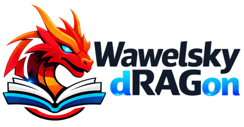

<div align="center">

<picture>
  <source media="(prefers-color-scheme: dark)" srcset="docs/assets/wawelsky-dragon-logo.png">
  
</picture>

**English** · [Polski](README.pl.md)

[](LICENSE)  

</div>

---

Wawelsky Dragon is a self-hosted RAG system: upload documents, parse and index them, then get answers with citations through a chat, a search page or an API. It exposes the **RAGFlow API**, so existing RAGFlow clients can switch by changing a URL and a key, while the application itself is **much lighter**: one MariaDB database instead of a separate SQL database, search engine, object store and Redis.

## Why Wawelsky Dragon

- **RAGFlow-compatible API.** `/api/v1` follows RAGFlow v0.27.2, with a shim for v0.24 clients. Response shapes are checked against recordings from the real upstream server.
- **One database, a few containers.** MariaDB holds metadata, vectors, full-text indexes, the task queue and the LLM cache, so there is one thing to back up and monitor. Files live on a volume.
- **Clear architecture.** Domain logic is separated from the API shapes, parsing runs in a separate worker, and every format is converted to HTML before going through a single chunker.
- **Secure by default.** Secrets are encrypted at rest (AES-256-GCM), application containers run as non-root, and the only published port is the web server's.
- **Any OpenAI-compatible model.** One client covers LiteLLM, OpenRouter, vLLM and similar gateways.

## Features

- **Knowledge bases:** PDF (text, tables, OCR), Office, HTML, Markdown, images, email; nine chunking methods; chunk editing and retrieval testing.
- **Chat and search:** hybrid vector and full-text retrieval, optional reranking, streaming answers with citations, AI summaries and related questions.
- **Metadata:** fields extracted by the model during parsing, and filters for chat, search and retrieval.
- **OCR on a GPU:** start a model on RunPod or on the server's own GPU from the admin panel.
- **Integrations:** SharePoint sync, an MCP server, API keys, Keycloak/OIDC single sign-on.
- **Operations:** migration from RAGFlow, knowledge base export and import, backup and restore, audit log, Polish and English UI.

## Quick start

Requires Docker with Compose v2, at least 16 GB of RAM and an OpenAI-compatible LLM gateway.

```bash
git clone https://github.com/lrozewicz/wawelsky-dragon.git
cd wawelsky-dragon
scripts/gen-secrets.sh           # creates .env with random secrets
$EDITOR .env                     # set WD_LLM_BASE_URL, WD_LLM_API_KEY, WD_ADMIN_EMAIL, WD_ADMIN_PASSWORD
docker compose up -d --build --wait
```

Open http://localhost:8080 and log in with the admin account. Full walkthrough: [Getting started](docs/en/getting-started.md).

## Documentation

| Topic | What you will find |
| --- | --- |
| [Getting started](docs/en/getting-started.md) | requirements, sizing, installation, health checks, running the tests |
| [Kubernetes](docs/en/kubernetes.md) | example manifests, installation, storage, ingress, upgrades |
| [Architecture](docs/en/architecture.md) | services, data flow, design decisions |
| [RAGFlow compatibility](docs/en/ragflow-compatibility.md) | what is compatible, what is left out, how to migrate |

More detailed documents are in Polish: [administrator runbook](docs/runbooks/admin.md) (models, SSO, API keys, SharePoint, OCR, MCP, upgrades), [backup and restore](docs/runbooks/backup-restore.md), [full index](docs/README.md).

## License and trademarks

Licensed under the [Apache License 2.0](LICENSE). Copyright 2026 Łukasz Różewicz.

Wawelsky Dragon contains portions derived from RAGFlow (InfiniFlow, Apache-2.0); see [NOTICE](NOTICE) and the [provenance list](docs/licensing/ragflow-provenance.md). It is an independent project, not affiliated with or endorsed by InfiniFlow. RAGFlow and other names are trademarks of their respective owners and are used here only to describe compatibility.
