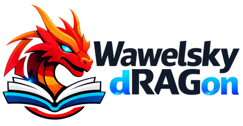

<div align="center">

<picture>
  <source media="(prefers-color-scheme: dark)" srcset="docs/assets/wawelsky-dragon-logo.png">
  
</picture>

[English](README.md) · **Polski**

[](LICENSE)  

</div>

---

Wawelsky Dragon to system RAG do uruchomienia na własnym serwerze: wgrywasz dokumenty, system je parsuje i indeksuje, a odpowiedzi z cytowaniami dostajesz przez czat, wyszukiwarkę albo API. Udostępnia **API RAGFlow**, więc dotychczasowi klienci RAGFlow przechodzą na niego zmianą adresu i klucza, a sama aplikacja jest **znacznie lżejsza**: jedna baza MariaDB zamiast osobnej bazy SQL, silnika wyszukiwania, magazynu obiektów i Redisa.

## Dlaczego Wawelsky Dragon

- **API zgodne z RAGFlow.** `/api/v1` odpowiada RAGFlow v0.27.2, a starsi klienci v0.24 mają warstwę zgodności. Kształty odpowiedzi są sprawdzane względem nagrań z prawdziwego serwera.
- **Jedna baza, kilka kontenerów.** MariaDB trzyma metadane, wektory, indeksy pełnotekstowe, kolejkę zadań i cache LLM, więc kopię zapasową i monitoring robisz dla jednej rzeczy. Pliki leżą na wolumenie.
- **Czytelna architektura.** Logika domenowa jest oddzielona od kształtów API, parsowanie działa w osobnym workerze, a każdy format jest zamieniany na HTML i przechodzi przez jeden chunker.
- **Bezpieczne ustawienia domyślne.** Sekrety są szyfrowane (AES-256-GCM), kontenery aplikacji działają bez roota, a jedyny publiczny port ma serwer WWW.
- **Dowolny model zgodny z OpenAI.** Jeden klient obsługuje LiteLLM, OpenRouter, vLLM i podobne bramki.

## Możliwości

- **Bazy wiedzy:** PDF (tekst, tabele, OCR), Office, HTML, Markdown, obrazy, e-maile; dziewięć metod chunkowania; edycja chunków i test wyszukiwania.
- **Czat i wyszukiwarka:** wyszukiwanie hybrydowe (wektory + pełny tekst), opcjonalny rerank, odpowiedzi strumieniowe z cytowaniami, podsumowania AI i powiązane pytania.
- **Metadane:** pola odczytywane przez model przy parsowaniu oraz filtry w czacie, wyszukiwarce i retrievalu.
- **OCR na GPU:** uruchomienie modelu na RunPod albo na GPU własnego serwera z panelu administratora.
- **Integracje:** synchronizacja SharePoint, serwer MCP, klucze API, logowanie przez Keycloak/OIDC.
- **Utrzymanie:** migracja z RAGFlow, eksport i import baz wiedzy, kopie zapasowe, dziennik audytu, interfejs po polsku i angielsku.

## Szybki start

Potrzebujesz Dockera z Compose v2, co najmniej 16 GB RAM i bramki LLM zgodnej z OpenAI.

```bash
git clone https://github.com/lrozewicz/wawelsky-dragon.git
cd wawelsky-dragon
scripts/gen-secrets.sh           # tworzy .env z losowymi sekretami
$EDITOR .env                     # ustaw WD_LLM_BASE_URL, WD_LLM_API_KEY, WD_ADMIN_EMAIL, WD_ADMIN_PASSWORD
docker compose up -d --build --wait
```

Otwórz http://localhost:8080 i zaloguj się na konto administratora. Pełny opis: [Pierwsze kroki](docs/pl/getting-started.md).

## Dokumentacja

| Temat | Co znajdziesz |
| --- | --- |
| [Pierwsze kroki](docs/pl/getting-started.md) | wymagania, dobór zasobów, instalacja, sprawdzenie działania, testy |
| [Kubernetes](docs/pl/kubernetes.md) | przykładowe manifesty, instalacja, pamięć masowa, ingress, aktualizacje |
| [Architektura](docs/pl/architecture.md) | usługi, przepływ danych, decyzje projektowe |
| [Zgodność z RAGFlow](docs/pl/ragflow-compatibility.md) | co jest zgodne, czego nie ma, jak migrować |

Szczegóły: [runbook administratora](docs/runbooks/admin.md) (modele, SSO, klucze API, SharePoint, OCR, MCP, aktualizacje), [kopie zapasowe](docs/runbooks/backup-restore.md), [pełny spis](docs/README.md).

## Licencja i znaki towarowe

Licencja [Apache License 2.0](LICENSE). Copyright 2026 Łukasz Różewicz.

Wawelsky Dragon zawiera fragmenty pochodzące z RAGFlow (InfiniFlow, Apache-2.0); zob. [NOTICE](NOTICE) i [listę pochodzenia](docs/licensing/ragflow-provenance.md). To niezależny projekt, niezwiązany z InfiniFlow ani przez tę firmę nie popierany. RAGFlow i inne nazwy są znakami towarowymi ich właścicieli i służą tu wyłącznie do opisania zgodności.
